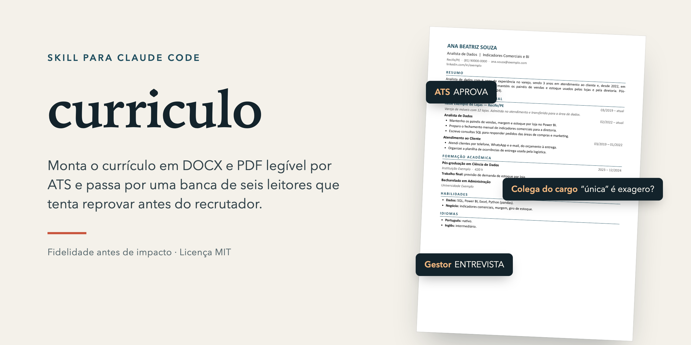
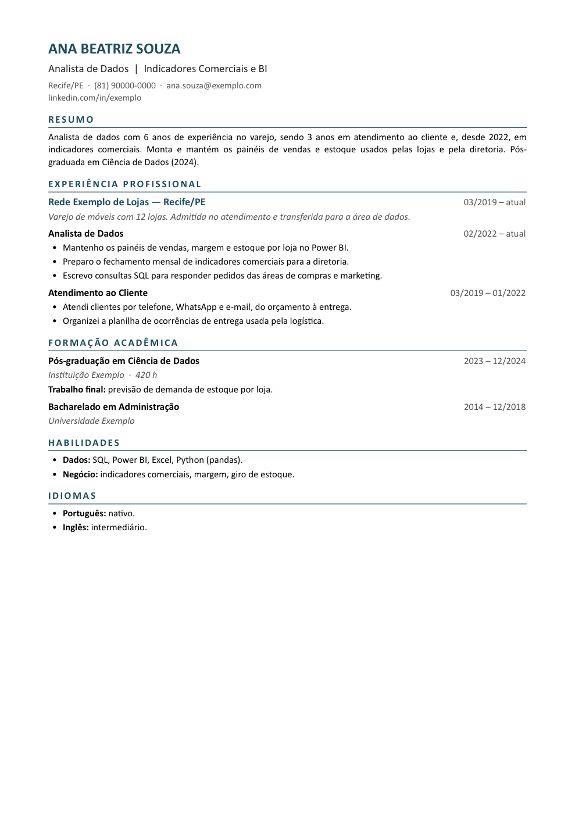

<p align="center"></p>

# curriculo

Skill para [Claude Code](https://claude.com/claude-code) que monta, revisa e atualiza currículo em DOCX e PDF, em português, e passa o texto por uma banca de seis leitores que tenta reprovar o currículo antes do recrutador.

A regra central é **fidelidade antes de impacto**: cada linha precisa ser algo que a pessoa sustenta numa entrevista. A skill não inventa números, resultados ou escopo. O que falta vira pergunta para a pessoa, e não estimativa.

## O que ela faz

1. **Lê as fontes**: texto, PDF, DOCX, Lattes e certificados. A versão mais recente, ou a que a pessoa editou, é a base.
2. **Pergunta as lacunas** numa mensagem só. Lacuna sem resposta fica fora do arquivo e vai para a lista de pendências.
3. **Banca de leitura**: seis leitores, cada um num subagente sem ver os outros.
4. **Escreve o texto** com as atribuições reais do cargo, no verbo que a pessoa usa.
5. **Gera os arquivos**: DOCX em A4, coluna única legível por ATS, foto opcional, e PDF exportado pelo Pages. Depois confere o visual página a página.
6. **Entrega** com pendências. Quando a pessoa devolve uma versão editada, compara as duas e aprende com o que ela mudou.

## A banca

| # | Leitor | Procura |
|---|---|---|
| 1 | Triagem automática (Gupy, Kenoby, Indeed) | Texto legível de cima a baixo, cargos e datas claros, termos da vaga |
| 2 | Gestor da vaga | Se dá entrevista, e o que decide nos primeiros dez segundos |
| 3 | Recrutador com 30 segundos | Só o terço de cima |
| 4 | Concorrente à mesma vaga | Onde o currículo é mais fraco que o dele |
| 5 | Colega que já ocupou o cargo | Exagero: "única", "todas", verbo maior que o papel, nível de ferramenta sem prova |
| 6 | Diretoria | O que a pessoa mudou, e quanto |

Os seis vereditos viram uma lista de problemas, do pior ao mais leve. Cada correção usa só fatos que a pessoa forneceu. No fim, a triagem automática lê de novo a versão nova e informa o veredito antes e depois.

A banca roda quando a pessoa pede uma avaliação, quando o currículo vai para uma vaga nova ou quando é a primeira versão. Ajustes pontuais não passam por ela, porque cada rodada dispara seis subagentes.

## Exemplo

[`exemplo/cv.json`](exemplo/cv.json) é um currículo fictício, e o resultado está em [`exemplo/curriculo-exemplo.pdf`](exemplo/curriculo-exemplo.pdf) e [`.docx`](exemplo/curriculo-exemplo.docx).

<p align="center"></p>

## Instalação

Como plugin do Claude Code:

```
/plugin marketplace add manoagois/curriculo-skill
/plugin install curriculo@curriculo-skill
```

Ou copiando a pasta da skill:

```sh
git clone https://github.com/manoagois/curriculo-skill.git
ln -s "$PWD/curriculo-skill/skills/curriculo" ~/.claude/skills/curriculo
# Codex: ln -s "$PWD/curriculo-skill/skills/curriculo" ~/.codex/skills/curriculo
```

## Uso

```
/curriculo ~/Downloads/curriculo-antigo.pdf  vaga: Analista de Dados Pleno
```

Ou em linguagem natural, como "melhora meu currículo para esta vaga", "esse currículo passa na triagem?" ou "registra a versão que eu editei".

## Requisitos

- **Node.js** e `docx@9.15.0`, instalado pela skill numa pasta de trabalho.
- **macOS com Pages** para exportar o PDF. Sem Pages, abra o DOCX no Word ou no LibreOffice e exporte o PDF por lá.
- **Python com pypdf e Pillow**, só para extrair e recortar a foto de um PDF ou do Lattes.

## Gerador

[`skills/curriculo/gerar.js`](skills/curriculo/gerar.js) monta o DOCX a partir de um JSON no formato de [`modelo.json`](skills/curriculo/modelo.json):

```sh
npm i docx@9.15.0
node skills/curriculo/gerar.js exemplo/cv.json cv.docx
```

## Estrutura

```
.claude-plugin/        manifesto do plugin e do marketplace
skills/curriculo/
  SKILL.md             passos e regras de texto
  banca.md             os seis leitores e a consolidação
  gerar.js             gerador do DOCX
  modelo.json          formato do JSON de entrada
exemplo/               currículo fictício e o resultado
assets/                imagens deste README
```

## Créditos

A banca é adaptada de [hiring-panel-skill](https://github.com/alexyc9381/hiring-panel-skill), de Alex Chen (licença MIT). Mudanças: seis leitores, contexto brasileiro e o leitor 5, que procura exagero.

Esta skill organiza a leitura do currículo com modelos de linguagem. Ela não garante entrevista nem emprego.

## Licença

[MIT](LICENSE)
